# bash-autosuggest

[](https://github.com/akazwz/bash-autosuggest/actions/workflows/ci.yml)
[](https://github.com/akazwz/bash-autosuggest/releases/latest)
[](LICENSE)
[](#installation)
[](Cargo.toml)

**Zero-lag, Fish/Zsh-style inline history autosuggestions & real-time syntax highlighting for native Bash** — implemented in Rust as a tiny, zero-dependency Bash loadable builtin (`.so`) that hooks GNU Readline directly.

<p align="center">
  
</p>

- **Sub-millisecond latency**: zero heap allocations on the per-keystroke hot path, byte-prefix history scanning (~0.13 ms over 10,000 entries), and a lazy `$PATH` + in-process Bash builtin/alias/function resolver with zero forks (< 0.6 ms startup overhead).
- **Real-time syntax highlighting**: highlights valid/invalid commands (green/red), precommands (`sudo`/`env`/`command`/`exec`/etc.), Bash keywords, pipes & redirections, quoted strings, `$VAR` expansions, `--flags`, existing file paths (underlined), and `# comments` — all in a single flicker-free terminal write.
- **100% native Bash**: no PTY wrapper, no 256-byte `bind -x` hijacking, no shell switching. Native `Tab` completion, `bash-completion`, `Ctrl+R`, Vi/Emacs modes, bracketed-paste active regions, UTF-8/CJK prompts & input, `tmux`, scripts, and CLI agents (`claude`, `codex`, `agy`, etc.) work untouched.
- **Tiny & dependency-free**: ~390 KB stripped `.so`, **0 external Rust crates**, builds offline in < 1 s.

---

## Quick Start

Install the latest prebuilt `.so` (`x86_64` / `aarch64`, verifies `SHA256SUMS`, no Rust required) and enable it in `~/.bashrc`:

```bash
curl -fsSL https://raw.githubusercontent.com/akazwz/bash-autosuggest/main/install.sh | sh -s -- --update-bashrc
exec bash
```

---

## Keybindings & Usage

| Key | Behavior (at end of line with ghost text) | Otherwise |
| :--- | :--- | :--- |
| `→` / `End` / `Ctrl+F` | Accept full suggestion | Normal `forward-char` / `end-of-line` |
| `Alt+→` / `Alt+f` | Accept next word | Normal `forward-word` |
| `←` / `Backspace` / `Tab` / `Ctrl+R` / `Enter` | Clears ghost text cleanly | Standard Readline behavior |

### Syntax Highlighting

Enabled by default (standard 16-color ANSI codes that adapt cleanly to your terminal theme):

| Element | Style | Examples |
| :--- | :--- | :--- |
| Valid command (PATH / builtin / alias / function / executable path) | Green | `git`, `echo`, `ll`, `./script.sh` |
| Unknown / invalid command | Red | `gti`, `nonexistent` |
| Precommand wrappers (next command also highlighted) | Green | `sudo apt`, `env FOO=1 cargo`, `time ls` |
| Reserved words, pipes & redirections | Magenta | `if`, `for`, `\|`, `&&`, `2>&1`, `>>` |
| Quoted strings (`'...'`, `"..."`) | Yellow | `'hello'`, `"hi $USER"` |
| Options, variables & assignments | Cyan | `--oneline`, `-n`, `$HOME`, `${PATH}`, `RUST_LOG=` |
| Existing file / directory arguments | Underline | `Cargo.toml`, `src/lib.rs`, `~/repo` |
| Comments | Dim gray | `# note` |

### Configuration & Runtime Controls

Customize the ghost text ANSI SGR style (default `38;5;242`) or toggle syntax highlighting (enabled by default):

```bash
export BASH_AUTOSUGGEST_STYLE="38;5;242"
export BASH_AUTOSUGGEST_HIGHLIGHT=1   # set to 0 to disable real-time syntax highlighting
```

Runtime builtin commands:

```bash
bash_autosuggest status         # show enabled state, style, highlight mode, and history count
bash_autosuggest highlight off  # disable syntax highlighting (keeps autosuggestions)
bash_autosuggest highlight on   # re-enable syntax highlighting
bash_autosuggest disable        # restore original Readline hooks and keybindings
bash_autosuggest enable         # re-enable hooks (also reloads env vars)
enable -d bash_autosuggest      # cleanly unload the shared library
```

---

## How It Works

Existing approaches to Bash autosuggestions trade off either performance or compatibility:

```text
ble.sh          : bind -x hijacks all 256 bytes -> pure-Bash reimplementation of a line editor
PTY wrappers    : terminal <-> PTY proxy <-> bash -> extra layer (risks tmux / TUI quirks)
Zsh / Fish      : great UX, but not POSIX/Bash compatible for scripts & Bash-oriented tooling
```

`bash-autosuggest` uses Bash's official **`enable -f` loadable builtin** interface to hook GNU Readline inside the Bash process itself:

```text
Keyboard -> /bin/bash (native GNU Readline handles editing, Tab, Ctrl+R, UTF-8)
                |
                +-- rl_redisplay_function hook (single flicker-free write)
                |     -> single-pass Bash tokenizer + in-process builtin/alias/function & lazy $PATH cache
                |     -> reads Bash's live in-memory history_list() (byte-prefix match, 0 allocations)
                |     -> repaints syntax-highlighted input + grey ghost suffix after cursor
                |
                +-- Right Arrow / End / Ctrl+F / Alt+Right / Alt+f (when at EOL)
                      -> inserts suffix natively via rl_insert_text()
```

### Comparison

| Aspect | `bash-autosuggest` | `ble.sh` | Zsh / Fish |
| :--- | :--- | :--- | :--- |
| **Bash compatibility** | **100% native Bash** | 100% native Bash | Different shell |
| **Architecture** | In-process `.so` Readline hook | Pure Bash script (~1 MB) | Native shell |
| **10k-entry history + highlight** | **~0.13 ms** | Tens to hundreds of ms | < 1 ms |
| **Extra startup overhead** | **< 0.6 ms** | Hundreds of ms to 1 s+ | Varies |
| **Binary / dependencies** | **~390 KB `.so`, 0 crates** | ~1 MB scripts + caches | Full shell + plugins |
| **History sync** | Direct `history_list()` read | Internal history mirror | Native |
| **Scope** | Inline history suggestions + real-time syntax highlighting | Full syntax highlight + menus | Full shell UX |

---

## Installation

### 1. One-line install / update / uninstall (Linux `x86_64` / `aarch64`)

Downloads the latest prebuilt `.so` from GitHub Releases, verifies `SHA256SUMS`, and installs atomically to `~/.local/lib/bash_autosuggest.so`:

```bash
# Install (prints the ~/.bashrc snippet without editing your config)
curl -fsSL https://raw.githubusercontent.com/akazwz/bash-autosuggest/main/install.sh | sh

# Install and automatically add a managed loader block to ~/.bashrc
curl -fsSL https://raw.githubusercontent.com/akazwz/bash-autosuggest/main/install.sh | sh -s -- --update-bashrc

# Update later (re-run the installer, then reload Bash)
curl -fsSL https://raw.githubusercontent.com/akazwz/bash-autosuggest/main/install.sh | sh && exec bash

# Uninstall (removes ~/.local/lib/bash_autosuggest.so and the managed ~/.bashrc block)
curl -fsSL https://raw.githubusercontent.com/akazwz/bash-autosuggest/main/install.sh | sh -s -- --uninstall
```

### 2. Debian / Ubuntu `.deb` package

Download the `.deb` for `amd64` or `arm64` from [GitHub Releases](https://github.com/akazwz/bash-autosuggest/releases/latest) and install via `apt`:

```bash
sudo apt install ./bash-autosuggest_*_amd64.deb
```

Then enable it in `~/.bashrc`:

```bash
if [[ $- == *i* && -f /usr/lib/bash/bash_autosuggest.so ]]; then
    enable -f /usr/lib/bash/bash_autosuggest.so bash_autosuggest 2>/dev/null && bash_autosuggest
fi
```

### 3. Build from source (zero crates, < 1 s compile)

Requires Rust 1.100+ (managed via `mise` or `rustup`):

```bash
git clone https://github.com/akazwz/bash-autosuggest.git
cd bash-autosuggest
mise run install   # or: cargo build --release
```

Then add to the end of `~/.bashrc`:

```bash
if [[ $- == *i* && -f "$HOME/.local/lib/bash_autosuggest.so" ]]; then
    enable -f "$HOME/.local/lib/bash_autosuggest.so" bash_autosuggest 2>/dev/null && bash_autosuggest
fi
```

Open a new terminal or run `exec bash`.

---

## Requirements & Non-Goals

- **Requirements**: Linux with Bash 5.x built with loadable builtin support (`enable -f`) and exported GNU Readline symbols (true by default on Debian 12/13, Ubuntu 22.04+, Fedora, Arch, RHEL 9+). Automatically disables itself on `TERM=dumb`.
- **Non-Goals**: Interactive popup completion menus and multi-line AST editing. Keeping scope focused on inline history suggestions and fast single-pass syntax highlighting keeps this plugin sub-millisecond and conflict-free.

## Development

```bash
mise run check      # fmt-check + clippy (warnings=deny) + unit tests + live PTY E2E tests
mise run install    # build release .so and install to ~/.local/lib/bash_autosuggest.so
mise run uninstall  # remove ~/.local/lib/bash_autosuggest.so
```

## License

[MIT](LICENSE)
